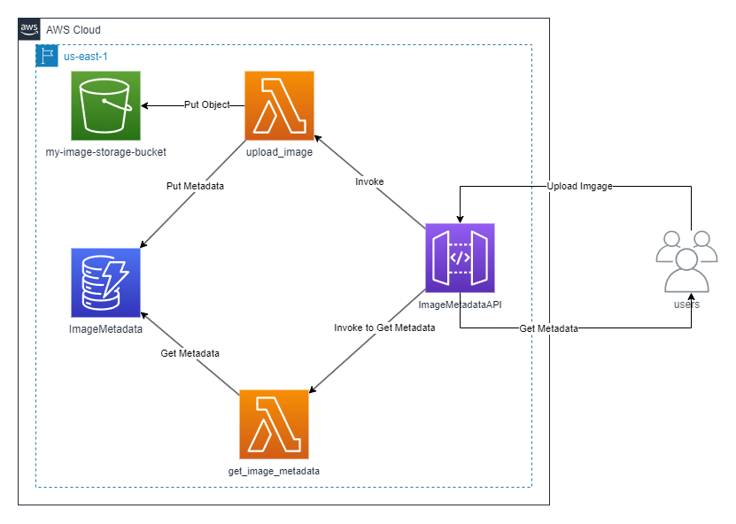
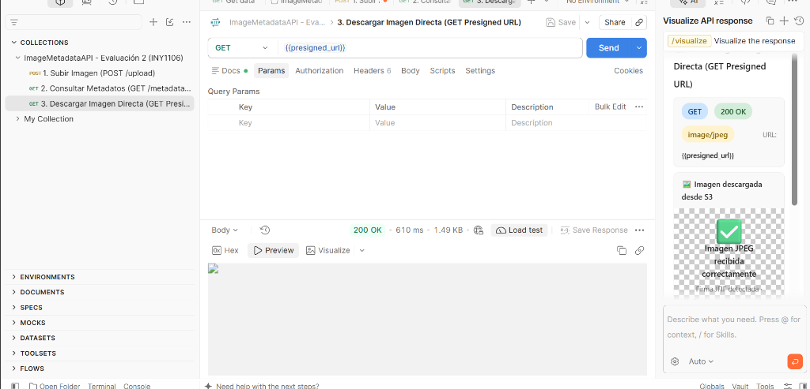

# Evaluación Parcial N°2: Infraestructura Serverless

## Proyecto: "Image Metadata API" en Amazon Web Services

- **Asignatura:** Infraestructura de Aplicaciones II (INY1106)
- **Estudiante:** José Villarroel
- **Carrera:** Ingeniería en Informática / Conectividad y Redes
- **Institución:** Duoc UC
- **Región AWS:** `us-east-1` (N. Virginia)
- **Cuenta AWS:** `[ACCOUNT_ID]` (AWS Academy Learner Lab)

---

## 1. Descripción y Arquitectura

El objetivo de esta evaluación es implementar una arquitectura serverless en AWS que permita:

1. Subir imágenes JPEG a un bucket de Amazon S3.
2. Guardar los metadatos (`image_id`, `key`, `url_s3` y `size`) en Amazon DynamoDB.
3. Consultar los metadatos mediante una API REST en Amazon API Gateway.
4. Ejecutar la lógica con AWS Lambda (Python 3.12).
5. Monitorear el funcionamiento con Amazon CloudWatch.

### Diagrama de arquitectura



### Flujo de la solución

1. El cliente envía `POST /upload` con el cuerpo binario de una imagen JPEG a API Gateway.
2. API Gateway invoca la función `upload_image` mediante integración proxy.
3. `upload_image` decodifica el cuerpo (si llega en base64), genera un `image_id` alfanumérico único, guarda el objeto en S3 con `ContentType='image/jpeg'`, guarda los metadatos en DynamoDB y devuelve una **URL prefirmada de descarga válida por 1 hora**.
4. El cliente envía `GET /metadata/{image_id}` a API Gateway.
5. API Gateway invoca `get_image_metadata`, que consulta DynamoDB por clave primaria, genera una nueva URL prefirmada a partir de la `key` almacenada y devuelve los metadatos en JSON.

---

## 2. Paso a Paso de Implementación

### Paso 1: Bucket Amazon S3 (IE2.2.1)

- **Nombre:** `my-image-storage-bucket-[ACCOUNT_ID]`
- **Región:** `us-east-1`
- **Cifrado:** SSE-S3 (habilitado por defecto)
- **Bloqueo de acceso público (Block Public Access):** activo (`BlockPublicAcls`, `IgnorePublicAcls`, `BlockPublicPolicy` y `RestrictPublicBuckets` en `true`)
- **Versionado:** deshabilitado


*Figura 1: Bucket `my-image-storage-bucket-[ACCOUNT_ID]` en `us-east-1`.*


*Figura 1.1: Bucket con las pruebas realizadas. El objeto de 536 bytes es el de la prueba final; el de 39 bytes corresponde a la subida anterior a la corrección del cuerpo binario.*

### Paso 2: Tabla DynamoDB (IE2.2.2)

- **Nombre:** `ImageMetadata`
- **Clave primaria (Partition Key):** `image_id` (tipo `String`)
- **Modo de capacidad:** On-Demand (`PAY_PER_REQUEST`)


*Figura 2: Tabla `ImageMetadata` con clave primaria `image_id`.*


*Figura 2.1: Metadatos registrados (`image_id`, `key`, `url_s3`, `size`).*

### Paso 3: Funciones AWS Lambda (IE2.1.1)

Ambas funciones usan runtime **Python 3.12**, timeout de **30 segundos** y rol de ejecución **`LabRole`**.

#### 3.1 `upload_image`

- **Handler:** `upload_image.upload_image`
- **Variables de entorno:**
  - `BUCKET_NAME`: `my-image-storage-bucket-[ACCOUNT_ID]`
  - `TABLE_NAME`: `ImageMetadata`


*Figura 3: Configuración, variables de entorno y timeout de `upload_image`.*

#### 3.2 `get_image_metadata`

- **Handler:** `get_image_metadata.get_image_metadata`
- **Variables de entorno:**
  - `TABLE_NAME`: `ImageMetadata`
  - `BUCKET_NAME`: `my-image-storage-bucket-[ACCOUNT_ID]`


*Figura 4: Configuración y variables de entorno de `get_image_metadata`.*

> **Nota:** `LabRole` es el rol preconfigurado del Learner Lab, con permisos amplios. Se usó por restricción del laboratorio, que no permite crear roles IAM personalizados con privilegios mínimos.

### Paso 4: API Gateway (IE2.2.3)

- **API:** `ImageMetadataAPI` (REST, regional)
- **ID de la API:** `t06m0zt6r6`
- **Stage:** `dev`
- **URL base:** `https://t06m0zt6r6.execute-api.us-east-1.amazonaws.com/dev`

| Método | Ruta | Integración | Función |
|---|---|---|---|
| POST | `/upload` | Lambda (AWS_PROXY) | `upload_image` |
| GET | `/metadata/{image_id}` | Lambda (AWS_PROXY) | `get_image_metadata` |

Ambas integraciones tienen permisos de invocación otorgados a `apigateway.amazonaws.com`.


*Figura 5: Recursos y métodos de `ImageMetadataAPI`.*


*Figura 5.1: Stage `dev` desplegado.*

---

## 3. Pruebas de Funcionamiento (IE2.3.1)

Las pruebas se realizaron con Postman contra el stage `dev`.

### 3.1 Subida de imagen: `POST /upload`

- **Endpoint:** `https://t06m0zt6r6.execute-api.us-east-1.amazonaws.com/dev/upload`
- **Body:** binario de una imagen JPEG real. Tamaño: 536 bytes.
- **Respuesta esperada:** `200 OK`

```json
{
  "message": "Image uploaded successfully!",
  "image_id": "ce5e7a8b53294831922d09422d5cedc3",
  "url": "https://my-image-storage-bucket-[ACCOUNT_ID].s3.amazonaws.com/ce5e7a8b53294831922d09422d5cedc3.jpg?AWSAccessKeyId=...&Signature=...&Expires=..."
}
```


*Figura 6: `POST /upload` exitoso con la JPEG de prueba.*

### 3.2 Consulta de metadatos: `GET /metadata/{image_id}`

- **Endpoint:** `https://t06m0zt6r6.execute-api.us-east-1.amazonaws.com/dev/metadata/ce5e7a8b53294831922d09422d5cedc3`
- **Respuesta esperada:** `200 OK`

```json
{
  "image_id": "ce5e7a8b53294831922d09422d5cedc3",
  "size": 536.0,
  "url": "https://my-image-storage-bucket-[ACCOUNT_ID].s3.amazonaws.com/ce5e7a8b53294831922d09422d5cedc3.jpg?AWSAccessKeyId=...&Signature=...&Expires=...",
  "key": "ce5e7a8b53294831922d09422d5cedc3.jpg",
  "url_s3": "https://my-image-storage-bucket-[ACCOUNT_ID].s3.amazonaws.com/ce5e7a8b53294831922d09422d5cedc3.jpg"
}
```


*Figura 7: `GET /metadata/{image_id}` devolviendo metadatos y URL prefirmada.*

### 3.3 Descarga mediante URL prefirmada

Al abrir la URL `url` del GET en el navegador, la imagen se visualiza sin autenticación adicional, porque la firma es válida durante 1 hora.


*Figura 7.1: Verificación de descarga directa desde S3 mediante URL prefirmada (HTTP 200 OK y firma JFIF detectada).*

### 3.4 Pruebas de error

| Prueba | Petición | Resultado esperado | Resultado obtenido |
|---|---|---|---|
| Body vacío | `POST /upload` sin cuerpo | `400 Bad Request` con `{"error": "No image data received"}` | `400`, registrado en CloudWatch como `Error de validacion: No image data received` |
| ID inexistente | `GET /metadata/nonexistent99999` | `404 Not Found` con `{"message": "Image not found"}` | `404` |

---

## 4. Troubleshooting, Monitoreo y Rendimiento (IE2.3.2)

### 4.1 Logs en CloudWatch

Grupos de registro: `/aws/lambda/upload_image` y `/aws/lambda/get_image_metadata`.

Extracto de una invocación de `upload_image` (cold start):

```text
REPORT RequestId: 31321f0b-b2ab-4efd-8764-0ce74418544b
  Duration: 505.51 ms
  Billed Duration: 1034 ms
  Memory Size: 128 MB
  Max Memory Used: 96 MB
  Init Duration: 528.08 ms
```

Extracto de una invocación de `get_image_metadata` (cold start):

```text
REPORT RequestId: cbdb0e9e-5215-4b34-bda5-6f018f2c55a9
  Duration: 279.26 ms
  Billed Duration: 701 ms
  Memory Size: 128 MB
  Max Memory Used: 90 MB
  Init Duration: 421.06 ms
```

Extracto de una invocación caliente (warm) de cada función:

```text
REPORT RequestId: bf62c881-8517-410d-9af9-2763ede7a29c
  Duration: 310.87 ms
  Billed Duration: 311 ms
  Memory Size: 128 MB
  Max Memory Used: 96 MB
```

```text
REPORT RequestId: 884d8143-ac5a-4b87-b055-a35a8429491e
  Duration: 39.70 ms
  Billed Duration: 40 ms
  Memory Size: 128 MB
  Max Memory Used: 90 MB
```


*Figura 8: Grupos de registro y eventos en CloudWatch Logs.*

### 4.2 Métricas

| Métrica | `upload_image` | `get_image_metadata` |
|---|---|---|
| Invocaciones (Invocations) | 5 | 5 |
| Errores de ejecución (Errors) | 0 * | 0 * |
| Duración (Duration) | 505.51 ms (cold) / 310.87 ms (warm) | 279.26 ms (cold) / 39.70 ms (warm) |
| Tiempo de inicialización (Init Duration) | 528.08 ms | 421.06 ms |
| Memoria máxima utilizada | 96 MB de 128 MB | 90 MB de 128 MB |

\* El contador nativo `Errors` de Lambda solo registra caídas no controladas del runtime. Como ambas funciones capturan las excepciones y devuelven códigos 400, 404 o 500 controlados, el contador registra 0.


*Figura 9: Métricas de invocaciones y duración en CloudWatch.*

### 4.3 Análisis

1. **Cold start frente a warm:** la inicialización (`Init Duration`) de `upload_image` es de 528.08 ms, comparable a su `Duration` de 505.51 ms. El costo de arranque se concentra en la inicialización del runtime y de los clientes boto3, por lo que la reutilización de clientes fuera del handler beneficia a las invocaciones posteriores en el mismo contenedor. El REPORT warm de upload_image (310.87 ms) frente al cold start (505.51 ms) muestra la diferencia entre inicializar el entorno y reutilizarlo.
2. **Memoria:** ambas funciones usan alrededor de 90–96 MB de los 128 MB configurados. Hay margen de memoria, pero la CPU asignada depende de la memoria configurada, por lo que subirla a 256 MB o 512 MB reduciría la duración de `upload_image`, que es la función más costosa (carga y escritura en S3).
3. **Función de subida frente a consulta:** Comparando ejecuciones del mismo tipo: en frío (cold start), `upload_image` tarda 505.51 ms frente a 279.26 ms de `get_image_metadata`, y en caliente (warm) tarda 310.87 ms frente a 39.70 ms, ya que en la subida el tiempo incluye la escritura en S3 y luego en DynamoDB, mientras que en la consulta solo se realiza lectura de DynamoDB y generación de la URL en memoria.

---

## 5. Optimización y Escalabilidad (IL2.3)

### 5.1 Acciones aplicadas

- **Clientes SDK fuera del handler:** `boto3` se inicializa una sola vez por contenedor, reduciendo la latencia de las invocaciones posteriores.
- **DynamoDB en On-Demand:** la tabla escala con la demanda sin provisionar capacidad, evitando errores de throttling en picos.
- **URLs prefirmadas:** las imágenes no pasan por la capa de cómputo para descargarse, y el bucket mantiene el bloqueo de acceso público.
- **Manejo de errores controlado:** los errores de validación devuelven 400, los recursos inexistentes 404 y las excepciones inesperadas 500, sin caídas del runtime.

### 5.2 Recomendaciones para producción (no implementadas)

- **Provisioned Concurrency** en `get_image_metadata`, si el endpoint de consulta requiere latencia estable en picos.
- **Subida directa a S3 con URL prefirmada de tipo PUT**, para que las imágenes no atraviesen API Gateway (que limita el tamaño del payload) ni Lambda.
- **Caché en API Gateway o DAX** si las consultas de metadatos se repiten con frecuencia.

---

## 6. Cómo Reproducir la Prueba

```bash
# 1. Subir una imagen JPEG
curl -X POST https://t06m0zt6r6.execute-api.us-east-1.amazonaws.com/dev/upload \
  -H "Content-Type: image/jpeg" \
  --data-binary "@ruta/a/tu/imagen.jpg"

# 2. Consultar los metadatos con el image_id devuelto
curl -X GET https://t06m0zt6r6.execute-api.us-east-1.amazonaws.com/dev/metadata/ce5e7a8b53294831922d09422d5cedc3

# 3. Descargar la imagen con la URL prefirmada devuelta en el paso 2
curl -o descarga.jpg "[URL_PREFIRMADA]"
```

---

## 7. Estructura del Repositorio

```
.
├── README.md
├── img/
│   ├── image_metadata_api_diagram.png   # Diagrama de arquitectura
│   ├── 01_s3_bucket.png                 # Bucket S3
│   ├── 01b_s3_objects.png               # Objeto en S3
│   ├── 02_dynamodb_table.png            # Tabla DynamoDB
│   ├── 02b_dynamodb_items.png           # Elementos en DynamoDB
│   ├── 03_lambda_upload.png             # Lambda upload_image
│   ├── 04_lambda_get.png                # Lambda get_image_metadata
│   ├── 05_api_gateway.png               # Recursos de API Gateway
│   ├── 05b_api_stage.png                # Stage dev
│   ├── 06_postman_post.png              # Prueba POST
│   ├── 07_postman_get.png               # Prueba GET
│   ├── 07b_download_presigned.png       # Descarga por URL prefirmada
│   ├── 08_cloudwatch_logs.png           # Logs de CloudWatch
│   └── 09_cloudwatch_metrics.png        # Métricas de CloudWatch
└── src/
    ├── upload_image.py                  # Lógica de subida y registro
    └── get_image_metadata.py            # Lógica de consulta de metadatos
```

---

## 8. Conclusión

La arquitectura Image Metadata API se implementó y probó en AWS Learner Lab con los servicios S3, DynamoDB, Lambda y API Gateway.

- **Almacenamiento:** las imágenes se guardan en S3 con el bloqueo de acceso público activo, y los metadatos en DynamoDB.
- **Backend:** las funciones Lambda manejan la subida, la consulta, la validación y los errores de forma controlada.
- **Acceso seguro:** la API entrega URLs prefirmadas válidas por 1 hora, en lugar de exponer el bucket.
- **Monitoreo:** CloudWatch Logs y Metrics permiten verificar la duración, la inicialización, la memoria y las invocaciones de cada función.
