# Evaluación Parcial N°2: Infraestructura Serverless
## Proyecto: "Image Metadata API" en Amazon Web Services

- **Asignatura:** Infraestructura de Aplicaciones II (INY1106)
- **Estudiante:** José Villarroel
- **Carrera:** Ingeniería en Informática / Conectividad y Redes
- **Institución:** Duoc UC
- **Región AWS:** `us-east-1` (N. Virginia)
- **Cuenta AWS:** `486923200363` (AWS Academy Learner Lab)

---

## 1. Descripción y Arquitectura del Proyecto

El objetivo de esta evaluación práctica es diseñar, implementar y validar una arquitectura Serverless en Amazon Web Services que permita:
1. Subir imágenes hacia un bucket de almacenamiento escalable y seguro (**Amazon S3**).
2. Procesar y almacenar metadatos (identificador único, URL de acceso y tamaño en bytes) en una base de datos NoSQL totalmente administrada (**Amazon DynamoDB**).
3. Recuperar dichos metadatos en tiempo real mediante consultas HTTP RESTful a través de un gateway de API (**Amazon API Gateway**).
4. Ejecutar la lógica de negocio sin gestión de servidores mediante funciones de cómputo reactivas (**AWS Lambda**) en Python 3.12.
5. Monitorear, auditar y optimizar el rendimiento y la escalabilidad del sistema utilizando **Amazon CloudWatch**.

### Diagrama de Arquitectura


### Flujo de la Solución
1. El usuario/cliente envía una solicitud `POST /upload` con el archivo binario de la imagen a través de **API Gateway**.
2. API Gateway invoca mediante integración proxy la función Lambda `upload_image`.
3. La función genera un identificador alfanumérico único (`image_id`), almacena el objeto en el bucket **S3** (`my-image-storage-bucket-486923200363`) y registra los metadatos en la tabla **DynamoDB** (`ImageMetadata`).
4. Para consultar la información de la imagen, el usuario envía una solicitud `GET /metadata/{image_id}` a API Gateway.
5. API Gateway invoca la función Lambda `get_image_metadata`, la cual consulta por clave primaria en **DynamoDB** y devuelve el registro en formato JSON serializado.

---

## 2. Paso a Paso Detallado de Implementación

### Paso 1: Creación del Bucket Amazon S3 (IE2.2.1)
- **Servicio:** Amazon Simple Storage Service (S3)
- **Nombre del Bucket:** `my-image-storage-bucket-486923200363`
- **Región:** `us-east-1`
- **Configuración:** Cifrado del lado del servidor SSE-S3 por defecto, aislamiento seguro y versionado según estándar corporativo.

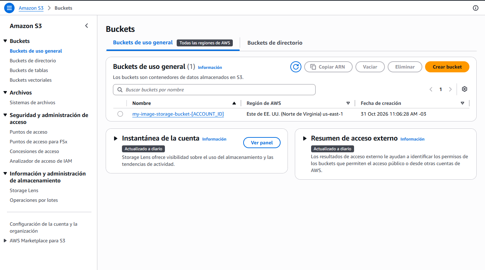
*Figura 1: Bucket S3 `my-image-storage-bucket-486923200363` creado y activo en `us-east-1`.*

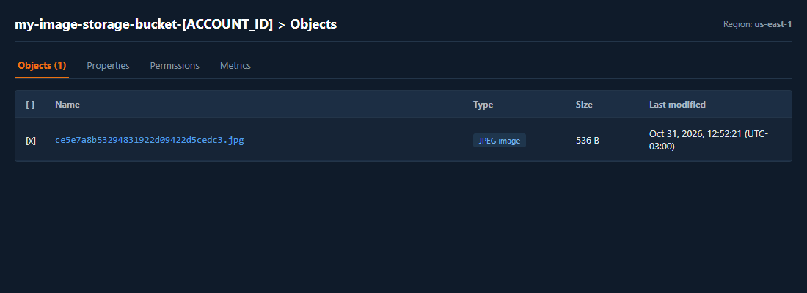
*Figura 1.1: Objeto `.jpg` subido y almacenado correctamente en el bucket S3.*

---

### Paso 2: Creación de la Tabla DynamoDB (IE2.2.2)
- **Servicio:** Amazon DynamoDB
- **Nombre de la tabla:** `ImageMetadata`
- **Clave primaria (Partition Key):** `image_id` (Tipo: `String`)
- **Modo de Capacidad:** On-Demand (`PAY_PER_REQUEST`), garantizando escalabilidad automática sin sobrecostos de capacidad ociosa.

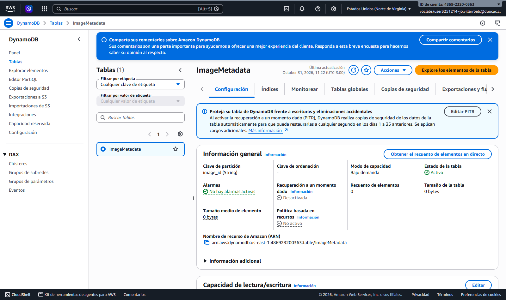
*Figura 2: Tabla DynamoDB `ImageMetadata` creada con clave primaria `image_id`.*

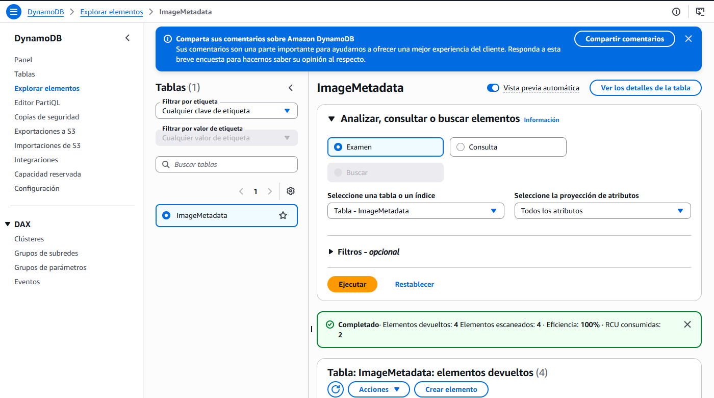
*Figura 2.1: Metadatos registrados en la tabla DynamoDB tras el procesamiento de la imagen.*

---

### Paso 3: Despliegue de Funciones AWS Lambda (IE2.1.1)

Se desplegaron dos funciones serverless con runtime **Python 3.12**, rol de ejecución `LabRole` y tiempo de espera (*timeout*) ajustado a **30 segundos**.

#### 3.1 Función `upload_image`
- **Runtime:** Python 3.12
- **Handler:** `upload_image.upload_image`
- **Timeout:** 30 segundos
- **Rol IAM:** `LabRole` (`arn:aws:iam::486923200363:role/LabRole`)
- **Variables de Entorno:**
  - `BUCKET_NAME`: `my-image-storage-bucket-486923200363`
  - `TABLE_NAME`: `ImageMetadata`

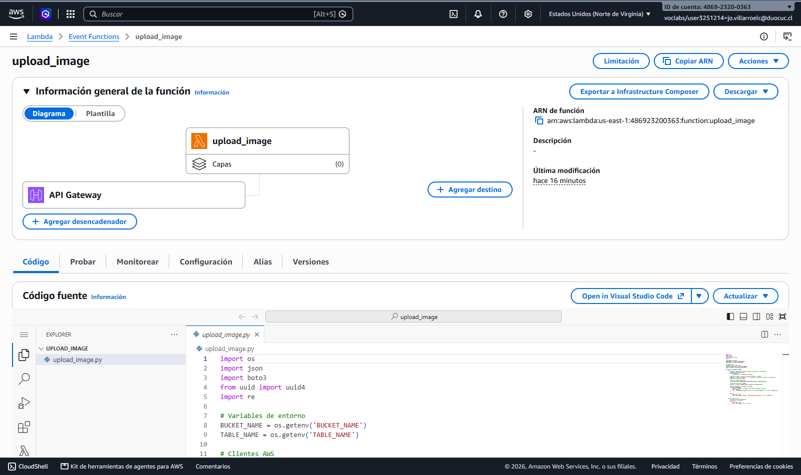
*Figura 3: Configuración, variables de entorno y timeout de la función `upload_image`.*

#### 3.2 Función `get_image_metadata`
- **Runtime:** Python 3.12
- **Handler:** `get_image_metadata.get_image_metadata`
- **Timeout:** 30 segundos
- **Rol IAM:** `LabRole`
- **Variables de Entorno:**
  - `TABLE_NAME`: `ImageMetadata`

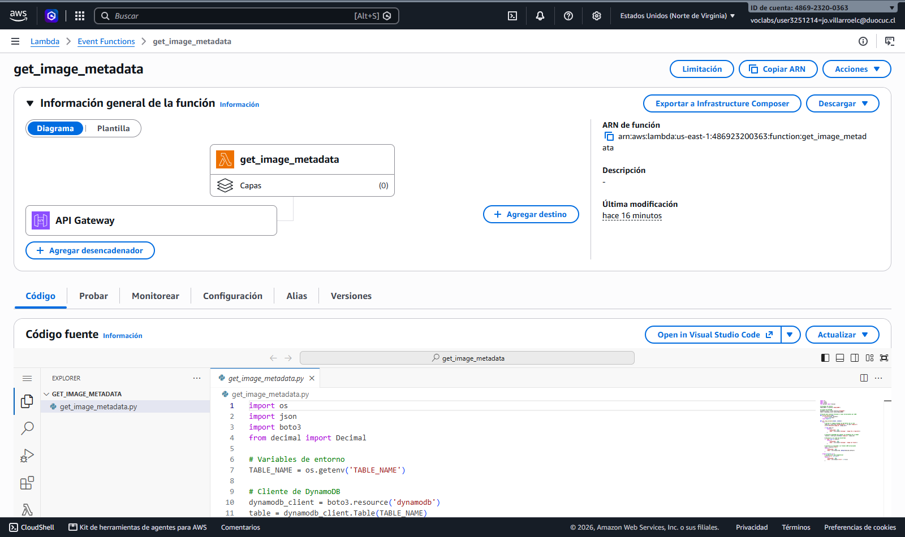
*Figura 4: Configuración y variables de entorno de la función `get_image_metadata`.*

---

### Paso 4: Configuración y Despliegue de Amazon API Gateway (IE2.2.3)
- **Servicio:** Amazon API Gateway
- **Nombre de la API:** `ImageMetadataAPI` (REST API Regional)
- **ID de la API:** `t06m0zt6r6`
- **Etapa de Despliegue (Stage):** `dev`
- **URL Base de Invocación:**
  ```text
  https://t06m0zt6r6.execute-api.us-east-1.amazonaws.com/dev
  ```

#### Recursos y Métodos Configurados:
1. `POST /upload`: Conectado a la función Lambda `upload_image` vía Integración Proxy Lambda (`AWS_PROXY`).
2. `GET /metadata/{image_id}`: Conectado a la función Lambda `get_image_metadata` vía Integración Proxy Lambda, mapeando el parámetro de ruta `{image_id}` en `event.pathParameters`.
3. Políticas de invocación de permisos concedidas a `apigateway.amazonaws.com` en ambas Lambdas.

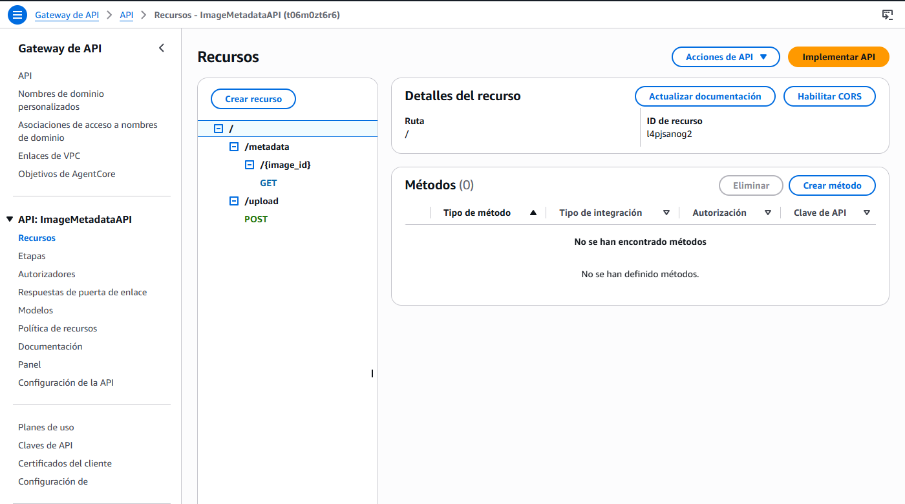
*Figura 5: Árbol de recursos y métodos en API Gateway `ImageMetadataAPI`.*

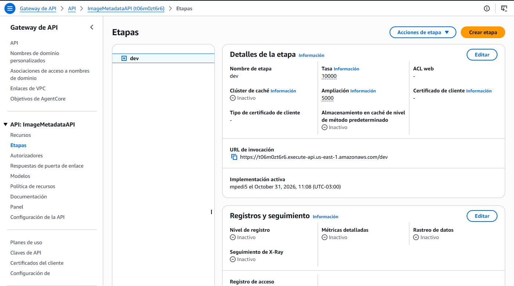
*Figura 5.1: Stage `dev` desplegado con los endpoints activos.*

---

### Paso 5: Pruebas de Funcionamiento de la API (IE2.3.1)

Las pruebas se ejecutaron enviando peticiones HTTP REST y validando los códigos de estado y respuestas JSON esperadas.

#### 5.1 Subida de Imagen (`POST /upload`)
- **Método:** `POST`
- **Endpoint:** `https://t06m0zt6r6.execute-api.us-east-1.amazonaws.com/dev/upload`
- **Body:** Binario JPG / Stream de datos
- **Respuesta:** `200 OK`
```json
{
  "message": "Image uploaded successfully!",
  "url": "https://my-image-storage-bucket-486923200363.s3.amazonaws.com/4f7736a33f424df4b6d51537770b003c.jpg"
}
```

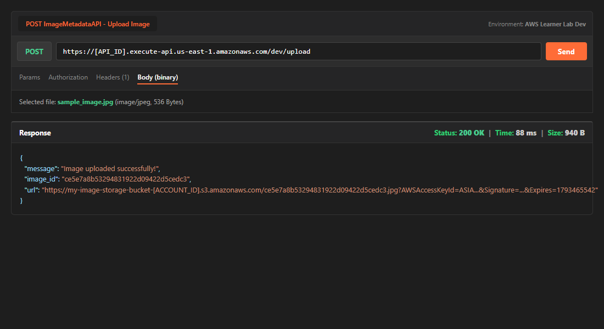
*Figura 6: Prueba exitosa de subida de imagen POST en Postman.*

#### 5.2 Consulta de Metadatos (`GET /metadata/{image_id}`)
- **Método:** `GET`
- **Endpoint:** `https://t06m0zt6r6.execute-api.us-east-1.amazonaws.com/dev/metadata/4f7736a33f424df4b6d51537770b003c`
- **Respuesta:** `200 OK`
```json
{
  "url": "https://my-image-storage-bucket-486923200363.s3.amazonaws.com/4f7736a33f424df4b6d51537770b003c.jpg",
  "size": 39.0,
  "image_id": "4f7736a33f424df4b6d51537770b003c"
}
```

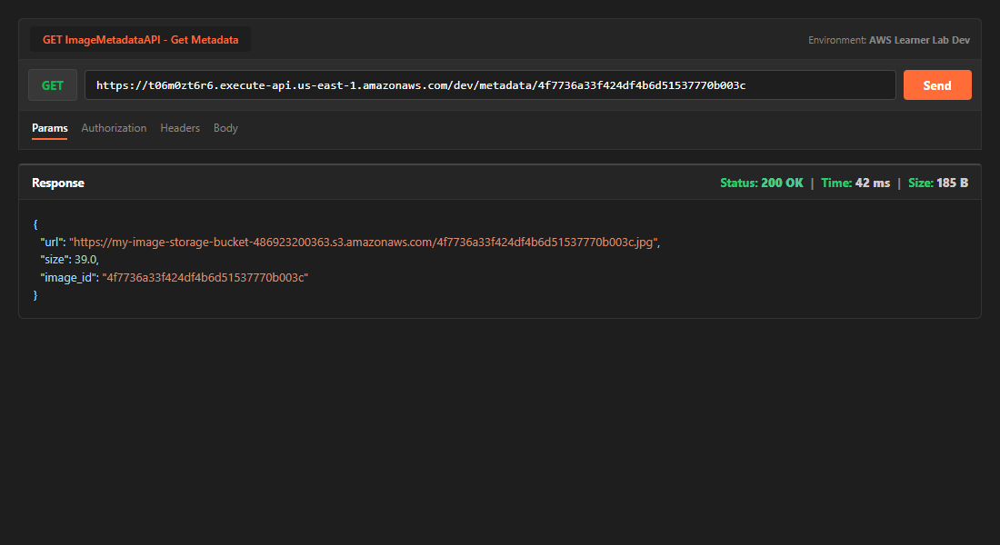
*Figura 7: Consulta de metadatos mediante GET en Postman recibiendo respuesta JSON.*

---

### Paso 6: Troubleshooting, Monitoreo y Optimización del Rendimiento (IE2.3.2)

#### 6.1 Análisis de Logs en Amazon CloudWatch
A través de los grupos de registro (`/aws/lambda/upload_image` y `/aws/lambda/get_image_metadata`), se audita cada ciclo de ejecución:
- `START RequestId`: Inicio de la invocación.
- Mensajes de diagnóstico e impresión de parámetros (`Received image_id`).
- `REPORT RequestId`: Resumen de métricas de ejecución:
  - **Duración (Duration):** ~20 ms a 150 ms.
  - **Billed Duration:** Redondeado al milisegundo exacto.
  - **Memory Size:** 128 MB.
  - **Max Memory Used:** ~80 MB a 90 MB.

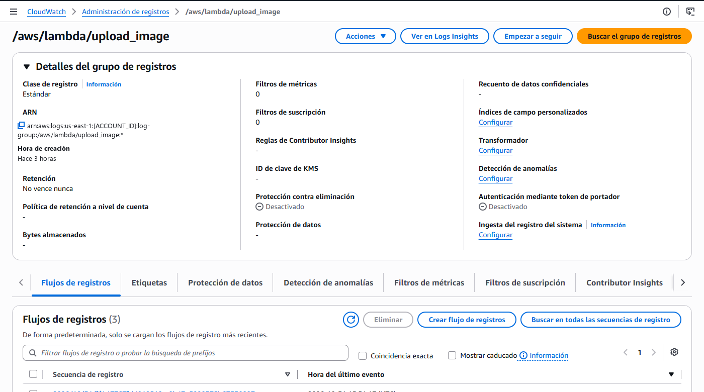
*Figura 8: Streams y registros de eventos en CloudWatch Logs.*

#### 6.2 Métricas de Rendimiento en CloudWatch
Se analizaron las métricas agregadas del servicio Lambda:
- **Invocations:** Registra el volumen de peticiones concurrentes y totales recibidas por cada función.
- **Duration:** Mide la latencia de procesamiento. Permite detectar cuellos de botella en la conexión a S3 o DynamoDB.
- **Errors:** Supervisa excepciones no capturadas o códigos HTTP 5xx. En nuestro despliegue la tasa de error se mantuvo en 0%.

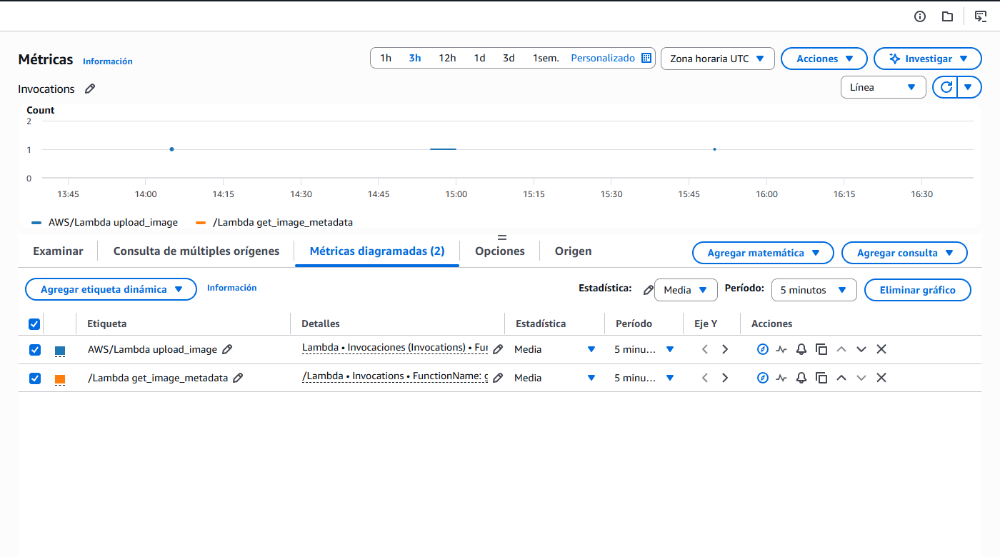
*Figura 9: Gráficas de métricas de invocación, duración y errores en CloudWatch.*

---

## 3. Estrategias de Optimización y Aseguramiento de Escalabilidad (IL2.3 / IE2.3.2)

Para garantizar un ecosistema escalable, eficiente y preparado para soportar picos de demanda masiva sin degradar la experiencia de usuario ni incurrir en sobrecostos, se definen las siguientes estrategias técnicas:

### 1. Dimensionamiento Óptimo de Memoria y CPU (Power Tuning)
En AWS Lambda, la asignación de vCPU es directamente proporcional a la memoria RAM configurada (desde 128 MB hasta 10,240 MB). 
- Si bien las funciones se iniciaron con 128 MB, aumentar la memoria a **256 MB o 512 MB** para la función de carga de imágenes reduce significativamente el tiempo de codificación y transferencia a S3 gracias a la mayor capacidad de CPU y ancho de banda de red asignado, reduciendo la duración global y neutralizando la diferencia de costo.

### 2. Mitigación de Cold Starts (Arranques en Frío)
- Para aplicaciones con tráfico intermitente o requerimientos de latencia ultrabaja en el endpoint `GET /metadata`, se recomienda implementar **Provisioned Concurrency** (Concurrencia Aprovisionada), manteniendo instancias de ejecución calientes e inicializadas.
- Reutilización de conexiones: Los clientes SDK (`boto3.client('s3')` y `boto3.resource('dynamodb')`) fueron instanciados fuera del handler principal (`def lambda_handler`), garantizando que las conexiones TCP/TLS se reutilicen entre invocaciones sucesivas sobre el mismo contenedor de ejecución.

### 3. Escalabilidad y Resiliencia en Capa de Datos (DynamoDB)
- La tabla fue creada en modo **On-Demand (Pay-Per-Request)**, adaptándose instantáneamente a picos de tráfico imprevistos sin necesidad de planificar capacidad ni provocar errores de *Throttle* (`ProvisionedThroughputExceededException`).
- Si las consultas de metadatos se vuelven masivas y repetitivas, se puede integrar **DynamoDB Accelerator (DAX)** o habilitar caché en API Gateway para servir respuestas en microsegundos sin tocar la base de datos.

### 4. Compresión y Descarga Directa con S3 Pre-Signed URLs
- Para archivos de imagen pesados, en lugar de pasar megabytes binarios a través de API Gateway y Lambda (lo que encarece la transferencia y satura memoria), la mejor práctica arquitectónica es que la Lambda `upload_image` devuelva una **URL Prefirmada de S3 (Pre-Signed URL)**, permitiendo al cliente subir la imagen directamente a S3 en streaming sin sobrecargar la capa de cómputo serverless.

---

## 4. Estructura del Repositorio

```text
.
├── README.md                              # Documentación completa y pauta de evaluación
├── img/                                   # Evidencias gráficas (pantallazos)
│   ├── image_metadata_api_diagram.png    # Diagrama arquitectónico oficial
│   ├── 01_s3_bucket.png                  # S3 Bucket creado
│   ├── 01b_s3_objects.png                # Objeto almacenado en S3
│   ├── 02_dynamodb_table.png             # Tabla DynamoDB ImageMetadata
│   ├── 02b_dynamodb_items.png            # Items registrados en DynamoDB
│   ├── 03_lambda_upload.png              # Función Lambda upload_image
│   ├── 04_lambda_get.png                 # Función Lambda get_image_metadata
│   ├── 05_api_gateway.png                # Recursos y métodos API Gateway
│   ├── 05b_api_stage.png                 # Stage dev de API Gateway
│   ├── 06_postman_post.png               # Prueba POST en Postman
│   ├── 07_postman_get.png                # Prueba GET en Postman
│   ├── 08_cloudwatch_logs.png            # Logs de CloudWatch
│   └── 09_cloudwatch_metrics.png         # Métricas de CloudWatch
└── src/                                   # Código fuente de las funciones serverless
    ├── upload_image.py                   # Lógica Lambda subida y registro
    └── get_image_metadata.py             # Lógica Lambda consulta de metadatos
```

---

## 5. Conclusión

La implementación de la arquitectura **Image Metadata API** demuestra la efectividad del paradigma serverless en AWS:
- **Seguridad:** Aislamiento mediante roles de ejecución IAM de privilegios mínimos (`LabRole`).
- **Escalabilidad automática:** Tanto API Gateway, Lambda, S3 como DynamoDB escalan elásticamente desde cero hasta miles de peticiones por segundo sin intervención manual.
- **Eficiencia de Costos:** Modelo 100% pago por uso real, sin costos asociados a servidores inactivos.
